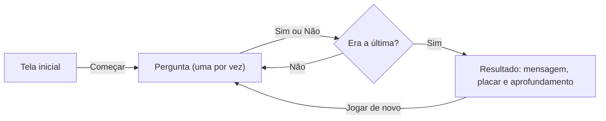

# Qual é a sua heresia? — Evolução do projeto

Jogo de perguntas **sim/não** sobre heresias e doutrina católica. A cada resposta, o jogador pode ser "enquadrado" em uma ou mais heresias da história da Igreja e, ao final, recebe uma mensagem bem-humorada, um placar e textos de aprofundamento (origem histórica e refutação bíblica) sobre os erros em que caiu.

Este documento registra **como o projeto nasceu, o que mudou em cada versão e quais decisões estruturais sustentam o código atual**. Ele foi escrito para dois públicos: quem quer entender a lógica por trás do jogo sem ser programador e quem quer evoluir o código.

| | |
|---|---|
| **Versão atual** | 0.2.0 |
| **Arquivo** | `index.html` (arquivo único) |
| **Tecnologias** | HTML5, CSS3 e JavaScript puro, sem frameworks e sem etapa de build |
| **Conteúdo** | 14 perguntas · 7 heresias |
| **Dependência externa** | Fontes do Google Fonts (sem internet, o navegador usa a fonte Georgia no lugar) |
| **Como executar** | Abrir o arquivo em qualquer navegador (computador ou celular) |

---

## 1. Visão geral da evolução

### Ponto de partida: a ideia

O projeto começou como uma ideia descrita em linguagem natural, com cinco objetivos:

1. A máquina faz perguntas baseadas em proposições heréticas e na doutrina da Igreja, com apenas duas respostas possíveis: sim ou não.
2. Conforme as respostas, o jogador é enquadrado em uma heresia, em várias ou em nenhuma.
3. O resultado usa um tom engraçado e irônico, sempre com a ressalva de que é só um jogo.
4. Quem quiser pode aprofundar: cada resposta herética leva a um texto com a retrospectiva histórica do erro e a razão bíblica pela qual ele está errado.
5. Objetivo pessoal do autor: **aprender a programar** durante o desenvolvimento.

O quinto objetivo influenciou as escolhas técnicas: o código precisava ser simples de abrir, simples de editar e comentado para estudo.

### Primeira decisão: onde e como construir

Escolheu-se uma página web em **um único arquivo** (HTML + CSS + JavaScript). Roda no navegador, não exige instalação e pode ser publicada gratuitamente depois. Dentro do arquivo, a organização segue três blocos bem marcados por comentários: **Dados**, **Lógica** e **Estilo/Estrutura**.

### Do MVP ao estado atual

| | Versão 0.1.0 (MVP) | Versão 0.2.0 (atual) |
|---|---|---|
| Perguntas | 8 | 14 |
| Heresias | 4 | 7 |
| Temas | Cristologia, antropologia e culto | Acrescenta o bloco de controvérsias cristológicas |
| Funções de lógica alteradas | n/a | **nenhuma** |

A passagem de 8 para 14 perguntas exigiu mexer apenas nos dados. Esse é o resultado prático da principal decisão de arquitetura do projeto (ver seção 3).

### O que da ideia original já existe

| Objetivo original | Situação | Observação |
|---|---|---|
| Perguntas sim/não | Concluído | Duas respostas por pergunta, sem meio-termo |
| Enquadramento em várias heresias | Concluído | Pontuação independente por heresia |
| Mensagens irônicas | Concluído | Quatro mensagens, escolhidas pelo número de heresias acumuladas |
| Textos de aprofundamento por resposta | Parcial | Aparecem em painéis expansíveis na tela de resultado; ainda não há páginas separadas |
| Cobertura histórica ampla (inclusive protestantismo e liberalismo) | Parcial | 7 heresias hoje; as de caráter "sistêmico" ainda não entraram |
| Aprender a programar | Em andamento | Código comentado em blocos; exercícios sugeridos para prática |

### Como o jogo funciona



**Regras de pontuação:**

- Cada pergunta define quantos pontos o "sim" e o "não" dão a cada heresia. A resposta **ortodoxa** não dá ponto algum.
- Cada heresia tem duas perguntas de 2 pontos, então o máximo é 4.
- Uma heresia conta como "enquadrada" quando o jogador chega a **2 pontos ou mais** nela.
- As respostas ortodoxas ficam **misturadas entre "sim" e "não"** de propósito, para que responder sempre a mesma coisa não leve a lugar nenhum.

**Mensagem final, conforme o número de heresias enquadradas:**

| Heresias | Título da mensagem |
|---|---|
| 0 | Doutor da Igreja? |
| 1 | Perigo à vista |
| 2 | Fundador de igreja |
| 3 ou mais | Caminho da fogueira |

---

## 2. Histórico de versões (changelog)

O projeto segue, de forma simplificada, o formato [Keep a Changelog](https://keepachangelog.com/pt-BR/1.1.0/) e o [Versionamento Semântico](https://semver.org/lang/pt-BR/). Enquanto a versão começar com `0.`, o jogo é considerado em desenvolvimento inicial.

Houve **dois marcos lógicos** até agora: o MVP (0.1.0) e a ampliação de conteúdo (0.2.0).

### [Não lançado] — ideias discutidas, ainda não implementadas

- Bloco da graça: semipelagianismo e predestinacionismo, combinando com o pelagianismo existente.
- Protestantismo, liberalismo, modernismo e indiferentismo, divididos em proposições concretas (por exemplo, *sola scriptura*, *sola fide*, presença real), porque não são heresias únicas.
- Pontuação por tema (cristologia, graça, Igreja), com resultados como "Cristologia: 3 desvios; Graça: nenhum".
- Percursos temáticos curtos, em vez de uma sequência única longa de perguntas.
- Ordem aleatória das perguntas.

### [0.2.0] — 2026-11-05 — Bloco de cristologia

**Adicionado**

- Três heresias, cada uma com texto de aprofundamento (contexto histórico, concílio que respondeu e base bíblica):
  - **Nestorianismo** (Éfeso, 431): a questão da maternidade divina de Maria e da unidade da pessoa de Cristo.
  - **Monofisismo** (Calcedônia, 451): a questão das duas naturezas de Cristo.
  - **Modalismo**: a questão da distinção entre as pessoas da Trindade.
- Seis perguntas novas: três em que o "sim" é o erro e três em que o "não" é o erro.
- No texto do nestorianismo, uma observação sobre o debate histórico a respeito do que Nestório de fato ensinava e a menção à declaração cristológica comum de 1994 entre a Igreja Católica e a Igreja Assíria do Oriente.

**Alterado**

- Texto da tela inicial: "Oito perguntas" passou a "Catorze perguntas".

**Não alterado, de propósito**

- Todas as funções de lógica, o CSS e as três telas. Todo o bloco novo entrou apenas na seção de **Dados**.

**Verificação**

- Foi executado um script de validação sobre o arquivo: sintaxe do JavaScript sem erros, 14 perguntas, todas as chaves de pontuação apontando para heresias existentes e máximo de 4 pontos em cada uma das 7 heresias.
- Ainda **não houve teste manual** em navegador ou celular.

### [0.1.0] — data a definir — MVP

**Adicionado**

- Estrutura em três telas: início, jogo e resultado.
- 8 perguntas e 4 heresias: Arianismo, Docetismo, Pelagianismo e Iconoclastia.
- Sistema de pontuação por heresia, com limiar de 2 pontos para "enquadrar" o jogador.
- Placar com uma barra por heresia e quatro mensagens finais irônicas.
- Painéis expansíveis "Para aprofundar", exibidos só para as heresias em que o jogador foi enquadrado, com origem histórica e refutação bíblica.
- Barra de progresso e contador de perguntas.
- Identidade visual própria: fundo azul-noite com detalhes em dourado, títulos em IM Fell English e texto em Alegreya Sans. As cores ficam em variáveis CSS, no topo do arquivo.
- Layout de coluna única, pensado para celular, e foco visível ao navegar pelo teclado.
- Código comentado em blocos (Dados, Lógica e Estilo) para servir de material de estudo.

---

## 3. Evolução: principais mudanças estruturais

### 3.1 Organização em camadas

Mesmo num arquivo único, o código separa responsabilidades:

| Camada | O que contém | Quando você mexe nela |
|---|---|---|
| **Dados** | `heresias`, `perguntas` e `mensagens` | Para criar conteúdo novo |
| **Lógica** | Estado do jogo e funções (`comecar`, `responder`, `mostrarResultado`) | Para mudar regras de pontuação ou comportamento |
| **Apresentação** | HTML das três telas e CSS | Para mudar aparência |

### 3.2 Separação entre dados e lógica (a decisão central)

Em vez de escrever cada pergunta dentro do código, o conteúdo fica em uma lista. Cada pergunta declara o efeito de cada resposta:

```js
{
  texto: `Em Cristo há uma só pessoa, a do Filho de Deus, que nasceu de Maria.`,
  sim: {},                       // resposta ortodoxa: nenhum ponto
  nao: { nestorianismo: 2 }      // resposta herética: 2 pontos para o nestorianismo
}
```

Um único trecho de código serve para todas as perguntas:

```js
function responder(resposta) {
  const efeito = perguntas[indice][resposta];
  for (const chave in efeito) pontos[chave] += efeito[chave];
  // ...avança para a próxima pergunta ou mostra o resultado
}
```

A função não sabe nada de teologia: ela só lê o efeito da resposta e soma os pontos. Por isso a versão 0.2.0 pôde adicionar três heresias e seis perguntas **sem alterar nenhuma função**. Um desenho possível mas ainda não usado: uma pergunta pode pontuar em mais de uma heresia ao mesmo tempo (por exemplo, `{ arianismo: 1, docetismo: 1 }`).

### 3.3 Telas controladas por estado

Existe uma única página. O JavaScript alterna a classe CSS `oculto` entre três blocos (início, jogo e resultado), e a tela de resultado é montada na hora a partir da pontuação. Não há navegação entre páginas nem recarregamento.

### 3.4 Pontos de atenção técnicos

Itens conhecidos que merecem cuidado quando o projeto crescer:

- **Valores fixos na lógica.** O máximo de 4 pontos (usado no placar e nas barras) e o limiar de 2 pontos para enquadrar estão escritos direto no código. Se o número de perguntas por heresia mudar, esses valores precisam passar a ser calculados a partir dos dados.
- **Textos longos dentro do JavaScript.** Com mais heresias, vale mover os textos de aprofundamento para arquivos próprios (Markdown ou JSON), mantendo o jogo enxuto.
- **Ambiguidade inerente ao formato sim/não.** Algumas respostas "não" pontuam uma heresia, mas poderiam vir de outra pessoa por outro motivo (quem nega que Pai, Filho e Espírito Santo sejam três pessoas distintas pode ser modalista, mas também outra coisa). Mais perguntas por heresia reduzem esse risco.
- **Revisão doutrinária.** Os textos de aprofundamento e as referências bíblicas devem ser conferidos nas fontes (Catecismo da Igreja Católica e atas dos concílios) antes de uma divulgação ampla.
- **Fontes externas.** A tipografia depende do Google Fonts; offline, o jogo funciona com a fonte reserva.
